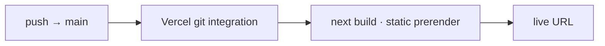

# ABHISHEK VERMA · DevOps Engineer

> Cloud · CI/CD · SRE — making release day a non-event.

[](https://abhishekvermaportfolio.vercel.app/)
[](https://nextjs.org)
[](https://www.typescriptlang.org)
[](https://vercel.com)


---

## 🚀 Overview

Personal **DevOps engineer portfolio** built with Next.js (App Router) + TypeScript.
An editorial "terminal" aesthetic — violet/cyan/amber theme, Fraunces serif display,
log-line section headers, monogram watermarks, and a custom crosshair cursor with a spark trail.

Content is real: 7+ years in infrastructure & cloud (Softbeads · Mrianso), resume,
projects, certifications, references, runbook playbooks, and the **OneView** dashboard.

## ✨ Features

- **OneView dashboard** — 3-column ops console: profile, system status, 12 core capabilities (Azure, AWS, Terraform, Ansible, K8s, Datadog/ELK, DevSecOps…), mission logs, live GitHub activity.
- **Terminal aesthetic** — log-line section headers (`## deploy.sh`), marquee of real CLI commands, preloader deploy pipeline.
- **Custom cursor** — theme-colored crosshair target + visible spark trail (light & dark safe).
- **Runbook cards** — deploy / incident / rollback playbooks.
- **Live GitHub widget** — recent public activity, graceful offline fallback.
- **Full theme support** — light + dark, entirely self-hosted fonts (Fraunces, Sora, JetBrains Mono).
- **Responsive** — 375px → 1440px; OneView stacks cleanly on mobile.

## 🛠 Stack

| Layer | Tech |
|---|---|
| Framework | Next.js 16 (App Router, static prerender) |
| Language | TypeScript (strict) |
| Styling | CSS custom properties (theme tokens), Flex/Grid |
| Fonts | Fraunces · Sora · JetBrains Mono (self-hosted) |
| Behavior | Vanilla JS modules (cursor / preloader / reveal) |
| Hosting | Vercel (native Git integration) |

## 🔁 Pipeline



## 🧑‍💻 Local development

```bash
npm install
npm run dev      # → http://localhost:3000
npm run build    # type-check + production build
```

## 📁 Structure

```
app/            # layout · home · globals.css · behaviors
components/     # sections · HeaderClient · OneViewPanel · Runbooks · ProgressBar
data/site.ts    # all site content (single source of truth)
public/req/     # fonts · images · js · resume pdf
vercel.json     # clean URLs · cache & security headers
```

## 🌍 Deploy

Import `abhishekverma1996/devopsportfolio` in Vercel → framework **Next.js** (auto-detect) → Deploy.
No extra flags: build `npm run build`, output **Next.js default**.

---

© 2026 Abhishek Verma · deployed from Kanpur · status: operational
