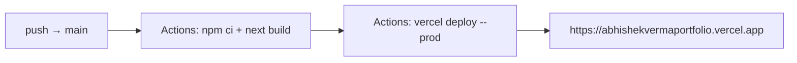

# Abhishek Verma — DevOps Engineer Portfolio

[](https://github.com/abhishekverma1996/portfolio/actions/workflows/deploy-vercel.yml)
[](https://abhishekvermaportfolio.vercel.app/)

Personal portfolio built with **Next.js (App Router) + TypeScript**. The UI language comes from a hand-tuned reference design, re-themed in azure, and the content is Abhishek's real data — experience, projects, stack, references, and contact.

## Stack

| Layer | Tech |
|---|---|
| Framework | Next.js 15 (App Router, SSR/SSG) |
| Language | TypeScript (strict) |
| Styling | CSS custom properties (theme tokens), Flex/Grid |
| Fonts | Space Grotesk + JetBrains Mono (self-hosted) |
| Behavior | Vanilla JS modules for cursor/preloader/reveal (injected post-hydration) |
| CI/CD | GitHub Actions — type-check + build + Vercel deploy |
| Hosting | Vercel (edge CDN, HTTPS, clean URLs) |

## Pipeline



## Local development

```bash
npm install
npm run dev      # → http://localhost:3000
npm run build    # type-check + production build
npm run start    # serve the production build
```

## Project structure

```
.
├── app/
│   ├── layout.tsx          # root layout: theme boot, fonts, backdrop, lenis
│   ├── page.tsx            # home — assembles all sections
│   ├── globals.css         # full design system (azure theme tokens)
│   └── behaviors.tsx       # client: injects cursor/preloader/main scripts
├── components/
│   ├── sections.tsx        # Preloader, Header, Hero, Marquee, About, Work
│   └── sections2.tsx       # Projects, Stack, Credentials, Contact, Footer
├── data/site.ts            # all site content (single source of truth)
├── public/req/             # fonts, images, js, resume pdf
├── vercel.json             # clean URLs, cache + security headers
└── .github/workflows/
    └── deploy-vercel.yml   # validate + deploy to Vercel
```

## Deploy to Vercel

**Fastest:** `npx vercel` at the repo root — Next.js is auto-detected.

**Via GitHub Actions (recommended):**
1. Push to GitHub (`abhishekverma1996/portfolio`).
2. Add repo secret `VERCEL_TOKEN` (vercel.com/account/tokens).
3. Add repo variables `DEPLOY_VERCEL=true` (+ optional `VERCEL_ORG_ID` / `VERCEL_PROJECT_ID`).
4. Push to `main` — workflow type-checks, builds, and deploys.
